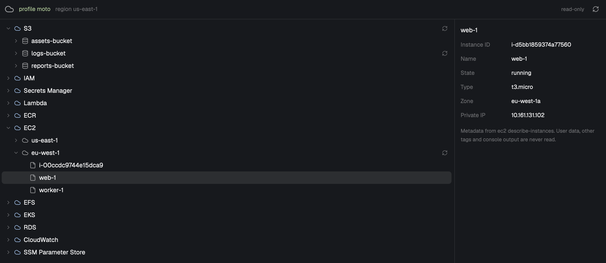

# aws-viewer

A read-only AWS viewer for [Herdr](https://herdr.dev). It shows S3 buckets and SSM Parameter Store parameters as a lazy tree with a details pane. It is a prototype.



See [RECIPE.md](RECIPE.md) for the full brief. The mod lives in `mods/aws-viewer/`.

## Install

Copy the mod folder into Herdr's mods directory:

```sh
cp -R mods/aws-viewer ~/.config/herdr-app/mods/aws-viewer
```

## Open it

```sh
herdr-app do tab.new --mod aws-viewer --props '{}'
```

Launch props (both optional):

- `profile`: the AWS profile to use.
- `region`: the AWS region to use.

Example: `--props '{"profile": "dev", "region": "eu-west-1"}'`.
Without props, the mod reads `AWS_PROFILE`, then `AWS_REGION` or `AWS_DEFAULT_REGION`, from your login shell.
The tab is renamed to the profile name, unless you named it yourself.

## Read-only

The mod never writes to AWS. Only `s3api list-buckets`, `s3api list-objects-v2`, `ssm describe-parameters` and `configure get` are allowed. Any argument that contains `decryption` is refused.

## What it does on your computer

- It runs `aws` with exactly these subcommands, and only these:
  - `aws s3api list-buckets`
  - `aws s3api list-objects-v2`
  - `aws ssm describe-parameters`
  - `aws configure get region` (a local read of your AWS config)
- It runs one `sh -c` login-shell call to read `AWS_PROFILE`, `AWS_REGION` and `AWS_DEFAULT_REGION`.
- It writes nothing: no files, no logs, no AWS changes.
- It shows no secrets. SSM parameter values are never fetched, only metadata.
- It never downloads S3 contents, only listings.
- Network access happens only through the AWS CLI.

## Requirements

- AWS CLI v2 on the `PATH` of your login shell.
- An AWS profile with list permissions.

## Limitations

- This is a prototype. The author tested it only lightly against real accounts.
- SSM has no folder API. The mod derives folders on the client from the parameter names on each page.
- It does not support remote machines.
- It has no search and no keyboard navigation.

## Tests

```sh
docker run --rm --network none -v "$PWD/mods/aws-viewer:/w:ro" -w /w node:22-slim node --test "tests/*.test.js"
```

## License

[MIT](LICENSE)

## Trademarks

AWS, Amazon S3 and the AWS logos belong to Amazon. This project is not affiliated with, endorsed by or sponsored by AWS.
The mod ships a neutral cloud icon. If you want an AWS logo, add your own locally and follow AWS's terms.
