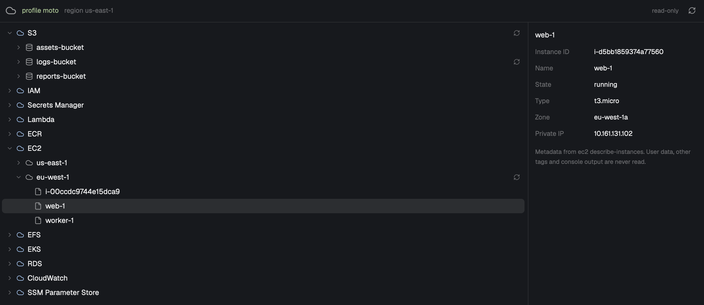

# AWS Viewer

A read-only browser for your AWS account, in a Herdr tab. A header shows the profile and region. Below it, a tree lists eleven services: S3, IAM, Secrets Manager, Lambda, ECR, EC2, EFS, EKS, RDS, CloudWatch and SSM Parameter Store. Selecting an item opens its metadata at the right. You can pass one region, or a list of regions so each regional service gets one group per region.

## What you see

The mod is one pane, 900 by 600 at first, in the theme's background and foreground colors. Text is 13px.

- **Header, 42px high**, with a bottom border. Left to right:
  - A neutral cloud icon (`cloud.svg`, 20px, muted color).
  - `profile <name>` in 12px, `ansi2` green. Before the profile is read it shows `Reading AWS_PROFILE…` in the dim color. With no profile it shows `profile (none)`. The tooltip says whether the profile came from props or from `AWS_PROFILE` (login shell).
  - `region <name>` in 12px dim. It shows `region (profile default)` when no region is known. If the `regions` prop is invalid, an error line in `ansi1` red replaces it (see Built from).
  - A spacer, then `read-only` in 11px dim.
  - A 26px reload button with the refresh icon.
- **Tree, left.** Rows are 26px high. Each level indents 16px. The tree scrolls and has 6px padding.
  - Eleven roots, in this order: `S3`, `IAM`, `Secrets Manager`, `Lambda`, `ECR`, `EC2`, `EFS`, `EKS`, `RDS`, `CloudWatch`, `SSM Parameter Store`. Roots use the accent-colored cloud icon.
  - Folders show a chevron (right or down). Leaves show no chevron. Icons: bucket for buckets, folder for folders, file for most leaves, key for secrets and SSM parameters.
  - Folders are sorted before leaves, then by name.
  - A spinner shows while a folder loads. A refresh button shows on loaded folders that make an `aws` call. Group rows (region groups, IAM, CloudWatch and its region groups) have no refresh button.
  - Hint rows: `Loading…`, the error text in red, and an empty text: `No buckets`, `Empty bucket`, `Empty folder`, `No parameters`, `No users`, `No roles`, `No groups`, `No local policies`, `No secrets`, `No functions`, `No repositories`, `No images`, `No instances`, `No file systems`, `No clusters`, `No DB instances`, `No details`. Other empty folders (CloudWatch Alarms and Log groups) show `Empty`.
  - A `Load more…` row in the accent color appears while a next page exists.
- **Details pane, right,** 320px wide with a left border. It appears only when a leaf is selected. It shows the leaf's name in bold, then label and value rows (label column 96px, dim), then a dim 11px note about what is never read.
  - S3 object: Bucket, Key, Size, Last modified, Storage class, ETag.
  - SSM parameter: Name, Type, Version, Last modified, Description, Tier, Data type.
  - IAM user: Name, ARN, User ID, Path, Created, Password last used. IAM role: Name, ARN, Role ID, Path, Created, Description, Max session (s). IAM group: Name, ARN, Group ID, Path, Created. IAM policy: Name, ARN, Policy ID, Path, Created, Updated, Attached to, Default version.
  - Secret: Name, ARN, Description, Last changed, Last accessed, Created.
  - Lambda function: Name, Runtime, Memory (`N MB`), Last modified, ARN.
  - ECR image: Repository, Tags (or `(untagged)`), Pushed, Size, Digest.
  - EC2 instance: Instance ID, Name, State, Type, Zone, Private IP.
  - EFS file system: File system ID, Name, Size, Performance mode, State.
  - EKS cluster details: Cluster, Version, Status, Endpoint, Created.
  - RDS instance: Identifier, Engine, Version, Class, Status, Endpoint.
  - CloudWatch alarm: Name, State, Metric, Namespace, Threshold, Last state update. Log group: Name, Stored, Retention (`N days` or `Never expire`), Created.
  - Dates show as `YYYY-MM-DD HH:MM UTC`. Missing values show `—`. Sizes show like `1.5 KB (1,536 bytes)`.
  - Below 640px width, the details pane moves under the tree, 240px high, with a top border.

## How it behaves

- **Props** (all optional):
  - `profile`: the AWS profile.
  - `region`: one region.
  - `regions`: a list of regions, such as `["us-east-1","eu-west-1"]`.
- **Start.** The mod reads `profile` and `region` from props. If either is missing, it asks the login shell for `AWS_PROFILE`, then `AWS_REGION`, else `AWS_DEFAULT_REGION`. Props win. If no region is known, it reads the profile's region with `aws configure get region` and shows it in the header. Nothing else loads until you open a node.
- **Global and regional services.**
  - S3 and IAM are global. They are shown once, whatever `regions` says.
  - SSM Parameter Store, Secrets Manager, Lambda, ECR, EC2, EFS, EKS, RDS and CloudWatch are regional.
  - Without `regions`, a regional service lists its resources directly, using the single region (or the profile default).
  - With `regions`, each regional service becomes a folder that holds one group per region, labelled with the region name, in the order given. Duplicates are dropped. Every `aws` call under a group gets that group's `--region`, so the group's region wins over the `region` prop. The same resource name in two regions is two separate rows.
  - A region group makes no call. Opening it shows the service's list, loaded on first open.
- **Fixed folders.** IAM opens to four folders with no call: `Users`, `Roles`, `Groups`, `Policies (local)` (customer-managed policies only). CloudWatch opens to two folders, `Alarms` (metric alarms) and `Log groups`. With `regions`, each CloudWatch region group holds those two folders. IAM does not change with `regions`.
- **Nested folders.**
  - S3: a bucket opens to its objects. Prefixes are folders and objects are leaves.
  - SSM: parameter names split on `/`. Each next segment is a folder. SSM has no folder API, so a "Load more" may add only new folders.
  - ECR: each repository is a folder of images.
  - EKS: each cluster is a folder that opens to one details leaf (labelled like `v1.30 ACTIVE`).
- **Click a folder row.** It opens or closes. The first open loads one page of 50 items. Reopening a folder that failed retries it.
- **Click a leaf.** It selects the leaf and shows details. This makes no AWS call.
- **Load more.** It loads the next page of 50 with the token.
- **Overlap guard.** While a folder loads, a second load for it is ignored.
- **Refresh button on a folder.** It drops that folder's rows and reloads it. Results from the older load are discarded.
- **Header reload button.** It reads the props and the login shell again, drops the whole tree and starts over.
- **Hover.** Rows and buttons get the theme's hover background. Long names show a tooltip with the full name, such as `s3://my-bucket/reports/`.
- **Errors** show inline in the tree, as short messages: expired login, no credentials, unknown profile, failing credential helper, access denied, missing bucket, no network, missing AWS CLI. Other failures show the first line of the CLI error, cut at 240 characters.
- **Bad `regions`.** If `regions` is not a list, or any name does not look like `xx-name-N`, the header shows `Refused: "<value>" is not a valid AWS region name.` in red and the tree is empty. No `aws` call runs.
- **Tab name.** For about 5 seconds after start, the mod renames its own tab to the profile name. It does nothing if you named the tab yourself.
- **No profile guard.** The mod uses whatever profile it is given, with no check or block on its name.
- There are no agent statuses. The mod does not look at agents.

## Built from

Mod `mods/aws-viewer/` with `mod.json` = `{ "place": "none" }`. Optional props `profile`, `region` and `regions`. It uses `View`, `div` and `svg` from `gpui-kit`, `v_flex` and `h_flex` from `gpui-base`, and `props`, `theme`, `exec`, `spaces`, `panes` and `run` from `herdr`. Theme colors: `background`, `foreground`, `border`, `muted`, `dim`, `accent`, `hover`, `selected`, `raised`, `ansi1`, `ansi2`.

**Programs it runs.** Only two, both through `exec` from `herdr`:

- `aws`, run as `exec("aws", argv)` in `aws.js` only.
- A login shell, run once per session as `exec("sh", ["-c", 'exec "${SHELL:-/bin/sh}" -lc "$1"', "aws-viewer", SCRIPT])`. `SCRIPT` is a fixed `printf` that prints the marker `__AWS_VIEWER_ENV__` and then `$AWS_PROFILE`, `$AWS_REGION` and `$AWS_DEFAULT_REGION`, one per line. Output before the marker is ignored. It is skipped when props give both `profile` and `region`.

The mod makes no network call of its own. Network access happens only inside the `aws` CLI. It writes no files and no logs.

**Module files** in `mods/aws-viewer/`:

- `main.js`: the view (class `AwsViewer`), header, layout, sessions and page loading. A session is one profile, one region list and one tree. Starting a new one makes results from the old one stale.
- `aws-args.js`: builds every `aws` argv, holds the read-only allowlist, and checks values (see below). Exports `invocation`, `isReadOnly`, `regionList`, `configuredRegion`, `Refusal`, `PAGE_SIZE` (50) and one builder per command.
- `aws.js`: **the only file that runs `aws`**. `runAws` returns parsed JSON. `profileRegion` runs `aws configure get region`.
- `env.js`: the login-shell read.
- `context.js`: `needsShellEnv`, `parseShellEnv`, `resolveTarget` (props first, then shell values).
- `resources.js`: the `SERVICES` list, the map from node kind to its `aws` command and parser, `isFolder`, `isGroupNode`, `pageCommand`, `parsePage`.
- `parse.js`: turns CLI JSON into tree items, one parser per service. Items carry metadata only.
- `tree.js`: lazy tree state: `createTree(services, regions)`, `toggle`, `startLoad`, `finishLoad`, `failLoad`, `refresh`, `select`, `visibleRows`. Holds the paging tickets and the overlap guard.
- `rows.js`: draws tree rows, hint rows and the `Load more…` row.
- `details.js` and `format.js`: the details pane and its text formatting.
- `errors.js`: short messages for failed `aws` calls and for a missing `aws` program.
- `tab-name.js`: renames the viewer's tab with `run("tab.rename", { id, name })`.
- `tests/`: `aws-args.test.js`, `parse.test.js`, `tree.test.js`, `misc.test.js`, and fake JSON in `tests/fixtures/`.
- Art, 24px stroke icons tinted with `text_color`: `cloud.svg`, `bucket.svg`, `folder.svg`, `file.svg`, `key.svg`, `chevron-right.svg`, `chevron-down.svg`, `refresh.svg`, `spinner.svg`.

**Read-only allowlist.** `invocation()` checks the first two words of the command before building an argv. Only these pass: `s3api list-buckets`, `s3api list-objects-v2`, `ssm describe-parameters`, `iam list-users`, `iam list-roles`, `iam list-groups`, `iam list-policies`, `secretsmanager list-secrets`, `lambda list-functions`, `ecr describe-repositories`, `ecr describe-images`, `ec2 describe-instances`, `efs describe-file-systems`, `eks list-clusters`, `eks describe-cluster`, `rds describe-db-instances`, `cloudwatch describe-alarms`, `logs describe-log-groups`, `configure get`. Anything else throws `Refused: "<two words>" is not a read-only call this viewer allows.` Any argument that contains `decryption` (any case) is refused the same way.

**Value checks.** Values use the `--flag=value` form, so a name that starts with `-` is never read as a flag. A resource name or token that looks like a URL (`^[a-z][a-z0-9+.-]*://`, any case) is refused, because the CLI would read `file://` from disk. A region must match `^[a-z]{2}(-[a-z]+)+-\d+$`.

**Every call** ends with `--profile=
` (only if a profile is set) `--region=<r>` (only if a region is set) `--output=json --no-cli-pager --no-cli-auto-prompt`.

**Commands and paging.** Page size is 50. Token flags are added only for pages after the first.

- `s3api list-buckets --no-paginate --max-buckets=50 [--continuation-token=T]`
- `s3api list-objects-v2 --no-paginate --bucket=B [--prefix=P] --delimiter=/ --max-keys=50 [--continuation-token=T]`
- `ssm describe-parameters --no-paginate [--parameter-filters=[{"Key":"Path","Option":"Recursive","Values":["/app"]}]] --max-results=50 [--next-token=T]`. The filter is left out at the root.
- `secretsmanager list-secrets --no-paginate --max-results=50 [--next-token=T]`
- These use the CLI's own paging, `--max-items=50 [--starting-token=T]`, with no `--no-paginate`, because the CLI rejects both together and they have no native page-size flag:
  - `iam list-users`, `iam list-roles`, `iam list-groups`, `iam list-policies --scope=Local` (the scope flag comes before `--max-items`)
  - `lambda list-functions`
  - `ecr describe-repositories`, and `ecr describe-images --repository-name=R`
  - `ec2 describe-instances`
  - `efs describe-file-systems`
  - `eks list-clusters`
  - `rds describe-db-instances`
  - `cloudwatch describe-alarms`
  - `logs describe-log-groups`
- `eks describe-cluster --name=C`: one call, not paged.
- `configure get region`: a local read of `~/.aws/config`, run only when no region is known.

Response fields read, per command: `Buckets[].Name/CreationDate/BucketRegion` and `ContinuationToken`; `CommonPrefixes`, `Contents`, `IsTruncated`, `NextContinuationToken`; `Parameters` and `NextToken`; `Users`, `Roles`, `Groups`, `Policies`; `SecretList`; `Functions`; `repositories`, `imageDetails`; `Reservations[].Instances[]` (only the `Name` tag is kept); `FileSystems` (size from `SizeInBytes.Value`); `clusters`, `cluster`; `DBInstances` (endpoint as `Address:Port`; the master username is never kept); `MetricAlarms`; `logGroups` (`creationTime` is epoch milliseconds). The next token is `NextToken` (or `ContinuationToken` for buckets).

## Watch out

- **Not verified live.** The AWS response shapes above came from the AWS CLI documentation, not from live calls. The UI was not run in Herdr in the build agent's environment. Only the pure modules are tested, with fake fixtures. A fresh build must run it once against a real account.
- **`preview.png` shows the earlier view** (S3 and SSM only). It should be retaken.
- The viewer blocks any argument that contains `decryption`, and any resource name that looks like a URL such as `file://`.
- The environment lookup uses a login shell (`$SHELL -lc`). `zsh -l` does not read `.zshrc`. Set `AWS_PROFILE` in `.zshenv` or `.zprofile`, or pass `profile` as a prop.
- Do not add `--no-paginate` to calls that use `--max-items`. The CLI rejects the pair. For S3, `--max-items` counts only `Contents`, so on a prefix-only level it could walk every page. That is why S3 uses `--no-paginate` with the native size and token.
- IAM policies list only customer-managed ones (`--scope=Local`). AWS managed policies are not listed.
- CloudWatch shows metric alarms only. Composite alarms are not shown.
- SSM root and folder pages list all descendants recursively, and the viewer groups them by next path segment. A "Load more" may add only new folders.
- Buckets in other regions rely on the CLI's S3 region redirect.
- With `regions`, node ids get an `@<region>` suffix. Keep that, or the same name in two regions will collide.
- It needs AWS CLI v2 on the login `PATH`. It does not support remote machines. It has no search and no keyboard navigation.
- The tab rename retries on render for about 5 seconds, because Herdr may not list the pane at start.
- Do not ship an AWS logo. The header uses the neutral cloud icon.

## Done when

- `herdr-app check mods/aws-viewer` passes.
- Opening with `--props '{"profile":"dev"}'` and a working login lists the eleven roots in the order above, and the header reads `profile dev`.
- Opening `S3` loads up to 50 buckets. Opening `IAM` shows `Users`, `Roles`, `Groups` and `Policies (local)` with no `aws` call.
- With `--props '{"profile":"dev","regions":["us-east-1","eu-west-1"]}'`, S3 and IAM appear once, and Lambda shows `us-east-1` and `eu-west-1`. Opening a group runs `aws lambda list-functions` with that group's `--region`.
- With `--props '{"regions":["nope"]}'`, the header shows the red `Refused` line, the tree is empty and no `aws` command runs.
- Selecting a leaf shows the details pane and runs no command.
- The tab is renamed to the profile name.
- `docker run --rm --network none -v "$PWD/mods/aws-viewer:/w:ro" -w /w node:22-slim node --test "tests/*.test.js"` passes.
